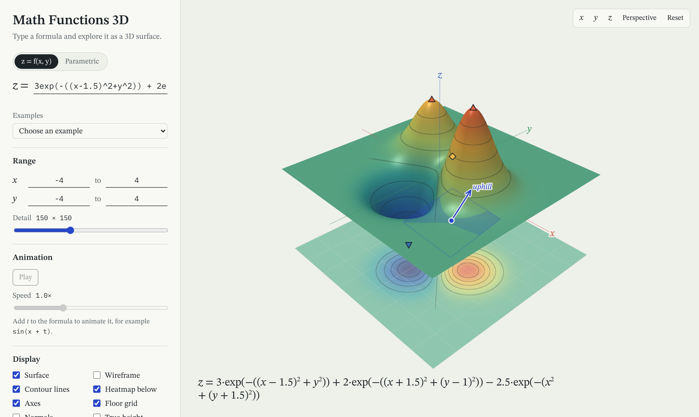

# Math Functions 3D for the web

The browser version of [Math Functions 3D](../README.md). Type a formula and it becomes an interactive 3D surface. Nothing to install.

**[Open it in the browser](https://lenka-sediva.github.io/math-functions/)**

<p>
  
</p>

## Features

- **Explicit surfaces** `z = f(x, y)` and **parametric surfaces** `(x, y, z) = P(u, v)`: torus, Möbius strip, Klein bottle, seashell and more
- **Animation** with the variable `t`, evaluated entirely on the GPU
- **Exact derivatives**: the app differentiates your formula symbolically and shows ∂f/∂x and ∂f/∂y
- **Point inspector**: click the surface to see its tangent plane, the direction of steepest ascent and the partial derivatives at that point
- **Maxima, minima and saddle points**, found with Newton's method and classified with the Hessian
- **Contour lines** and a **heatmap** below the surface
- **STL export** for 3D printing, closed into a solid with walls and a base
- **Shareable links**: the formula, ranges, display options and camera are stored in the URL
- Works on phones and tablets (touch: drag, pinch, two-finger pan)

## How it works

```
formula text ──► tokenizer ──► Shunting-yard ──► AST ─┬─► simplify ◄── symbolic derivative
                                                       ├─► JavaScript function (CPU: picking, STL, Newton)
                                                       ├─► GLSL code (GPU: every vertex, every frame)
                                                       └─► typeset HTML (caption, derivatives)
```

### One parser, four back-ends

The parser uses the same Shunting-yard algorithm as the Java version, but instead of evaluating the postfix form directly it builds an **abstract syntax tree**. Everything else works on that tree:

| File | What it does |
|---|---|
| [`math/tokenizer.ts`](src/math/tokenizer.ts) | Splits the text into tokens, inserts implicit multiplication (`2x`, `(x+1)(x-1)`), and gives errors with positions such as *Unknown name "xy". Did you mean x\*y?* |
| [`math/parser.ts`](src/math/parser.ts) | Shunting-yard to postfix, then postfix to a tree. Handles precedence, the right-associative `^`, unary minus (`-2^2 = -4`, `2^-x = 2^(-x)`) and functions with several arguments |
| [`math/derivative.ts`](src/math/derivative.ts) | Symbolic differentiation with the sum, product, quotient, power and chain rules, for all 25 functions |
| [`math/simplify.ts`](src/math/simplify.ts) | Folds constants and removes neutral elements, so `1*cos(x)*1 + 0` becomes `cos(x)` |
| [`math/codegen.ts`](src/math/codegen.ts) | Compiles the tree to JavaScript (`new Function`), to GLSL, to plain text and to typeset HTML |

### The surface is computed on the GPU

The desktop version sampled the function on the CPU and sent triangles to OpenGL's fixed-function pipeline. Here the mesh is just a flat grid of `(s, r)` coordinates in `[0, 1]²` that never changes. The formula and its derivatives are compiled to GLSL and pasted into the **vertex shader** ([`render/shaders.ts`](src/render/shaders.ts)), so the GPU computes the position and normal of every vertex on every frame. Animating `t` costs nothing on the CPU, even at 400 × 400 = 160,000 vertices.

**Normals are exact.** Instead of central differences, the normal is the cross product of the two symbolic tangents ∂P/∂u × ∂P/∂v. For `z = f(x, y)` that is `(1, 0, f_x) × (0, 1, f_y)`. Lighting (warm key light and cool fill light, Blinn–Phong) is computed per pixel in the fragment shader.

GLSL behaves differently from Java and JavaScript in a few places, so the generated code uses small helpers: `pow` of a negative number is undefined in GLSL but `(-2)^3 = -8` in maths; `mod` uses floor instead of truncation; `atan(0, 0)` is undefined.

### Undefined values and poles

- `NaN` fails every comparison, so a single `all(greaterThanEqual(p, clipMin))` test in the shader hides points like `sqrt(-1)` or `0/0`. A triangle that touches a hidden vertex is discarded in the fragment shader.
- The bounding box comes from **percentiles** of a sample, so one pole like `1/x` doesn't squash the whole plot ([`math/surface.ts`](src/math/surface.ts)).
- Next to a pole, as in `tan(x)`, a mesh would normally draw a vertical "wall" from +∞ to −∞. The shader looks at neighbouring vertices, and a big jump that goes *against* the local slope (known exactly from the derivative) means the function passed through infinity. Those vertices are hidden.

### Contour lines without geometry

Contours are drawn in the fragment shader: `fract(height / step)` gives the distance to the nearest level, and `fwidth` keeps the lines about one pixel wide at any zoom. A second limit in height units stops lines from smearing on almost flat areas.

### Analysis on the CPU

- **Picking** ([`render/renderer.ts`](src/render/renderer.ts)) casts a ray from the camera through the mouse position against a CPU copy of the mesh (Möller–Trumbore ray–triangle intersection).
- **Critical points** ([`math/critical.ts`](src/math/critical.ts)): Newton's method on ∇f = 0 from a grid of starting points, with the Hessian built from the symbolic second derivatives, then the second-derivative test `D = f_xx f_yy − f_xy²`.
- **STL export** ([`export/stl.ts`](src/export/stl.ts)) writes binary STL. For printing, an explicit surface is closed with four walls and a bottom whose edges match exactly, so the mesh is watertight (a test checks that every edge belongs to exactly two triangles).

### No libraries

The 3D math ([`render/mat4.ts`](src/render/mat4.ts)), the orbit camera, the shaders and the UI are written from scratch with WebGL2 and TypeScript. The only runtime dependencies are two fonts (STIX Two Text and IBM Plex Mono).

## Running locally

You need Node.js 20 or newer.

```bash
cd web
npm install
npm run dev       # development server with hot reload
npm test          # unit tests (Vitest)
npm run build     # production build in web/dist
```

## Tests

The tests in `src/**/*.test.ts` check:

- the parser: precedence, associativity, implicit multiplication and error messages
- symbolic derivatives against numerical differentiation for 14 formulas, at several points
- that the simplifier never changes a value
- critical points: the saddle of x² − y² and all four points of sin(x)·cos(y)
- STL: file size, scaling, and that the closed solid is watertight
- pole detection: `tan(x)` is cut at its poles, a steep saddle on a coarse grid is not
- shareable links: encoding and decoding the state gives the same state back

## Deployment

Every push to `master` that changes `web/` runs [`pages.yml`](../.github/workflows/pages.yml): install, test, build, and publish to GitHub Pages.
